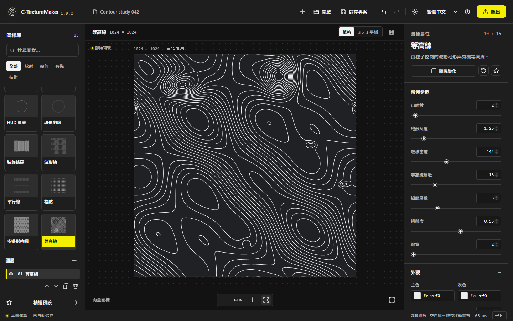

# C-TextureMaker

An offline Windows pattern studio for creating transparent, seamless-ready assets from 15 adjustable procedural pattern families, with SVG and PNG export.

[繁體中文](README.md) · [English](README.en.md) · [日本語](README.ja.md)

**v1.0.2 public preview** · [Download the Windows x64 portable package](https://github.com/ga643116/C-TextureMaker/releases/download/v1.0.2/C-TextureMaker-1.0.2-win-x64.zip) · [Release](https://github.com/ga643116/C-TextureMaker/releases/tag/v1.0.2) · [Source](https://github.com/ga643116/C-TextureMaker)

The main branch is now **1.1.0**; the public download above remains **v1.0.2**.

More workspace views

**Contour generation** — Watch contours form from the selected parameters.

**Seamless export** — Inspect a single tile and its seamless repeat.

## Features

- 15 pattern families: concentric arcs, halftone dots, HUD gauges, radial ticks, decorative barcodes, wave lines, parallel lines, dot grids, polygon grids, contours, symbol arrays, nested polygons, a globe, engineering grids, and radial beams.
- Adjust shape, color, rotation, scale, and position live. Use layers, presets, undo/redo, and .ctm projects. Projects support up to 16 layers; work and preferences are saved locally.
- Seamless mode arranges patterns to the canvas tile period. The 3 × 3 preview helps inspect seams; exports remain a single tile.
- Separate cursor and hand tools; hold Space and drag to pan temporarily. Dot and polygon cells support adjustable paint/erase brushes with one undo per stroke.
- A shared PNG/SVG library works across halftone, dots, polygon lattices and symbols. Base grid and diagonal lines have independent dash settings.
- Traditional Chinese, English, and Japanese interfaces, with dark and light themes.

## Download and launch

1. Download [C-TextureMaker-1.0.2-win-x64.zip](https://github.com/ga643116/C-TextureMaker/releases/download/v1.0.2/C-TextureMaker-1.0.2-win-x64.zip) and extract the entire archive.
2. Open C-TextureMaker.exe. Keep the app folder and DLL files beside it.
3. Place the whole folder somewhere writable so the app can save work and preferences in the adjacent data folder.

Requirements: Windows x64, .NET Framework 4.7.2 or later, and the Microsoft Edge WebView2 Runtime installed on the system. With those components present, the app runs offline and needs no Node.js, Python, account, or development server. It does not install or update system components. Before closing, check that the status bar says “Autosaved.” Save a .ctm project separately when moving or backing up a design.

## Patterns and export

Canvas dimensions range from 128 to 4096 px per side. PNG supports transparent or solid backgrounds and 1×, 2×, and 4× scale. Output is limited to an 8192 px longest edge and 32 MP total; both limits apply.

Procedural patterns export as vector SVG. Imported PNGs are embedded as raster images, so an SVG containing an imported PNG is not fully vector. Halftone, dots, polygon lattices and symbols share imported PNG/SVG shapes, preserving their original colors and transparency. The local library holds up to 40 shapes and 32 MiB in total, with a 4 MiB limit per file. Applied shapes are embedded in projects and survive library removal. Halftone also supports alpha masks. Decorative barcodes are not intended for scanning.

## Build from source

Builds require Node.js/npm and Python. These commands install development dependencies, run automated tests, build the frontend and Windows desktop app, and package the portable release:

    npm ci
    npm test
    npm run build
    powershell -NoProfile -ExecutionPolicy Bypass -File .\build-desktop.ps1
    python scripts/package.py

For browser interaction regression tests, install Playwright and Microsoft Edge, run `npm run build`, then `node tests/editor.browser.cjs`.

On the first desktop build, the script downloads the pinned WebView2 SDK from NuGet. The packaged app does not need build tools or a development server.

## License and credits

The project’s own source code is licensed under [MPL-2.0](https://www.mozilla.org/MPL/2.0/); see [LICENSE-SCOPE.md](LICENSE-SCOPE.md) for its scope. Commercial use is allowed. If you distribute modified MPL-covered files, you must make the source of those modified files available under MPL-2.0. Read the full terms in [LICENSE](LICENSE).

Transitions.dev animation and Microsoft WebView2 components retain their own terms, so the complete product should not be described as governed by MPL-2.0 alone. See [THIRD-PARTY-NOTICES.txt](THIRD-PARTY-NOTICES.txt), the [Transitions.dev license](app/vendor/LICENSE.txt), and LICENSE-WebView2.txt in the portable package.

Pattern workflow references [rahoo 素材生成](https://rahoo.online/); this local implementation does not copy its code or artwork. The opening generation animation is from the [official Transitions.dev source](https://github.com/Jakubantalik/transitions.dev/tree/main/skills/transitions-ui-generation).
