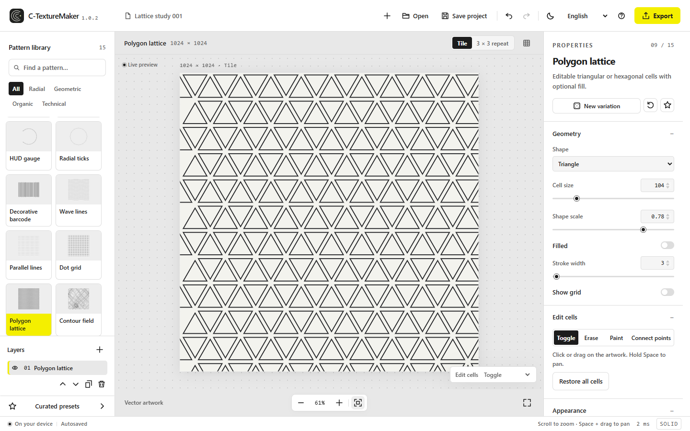
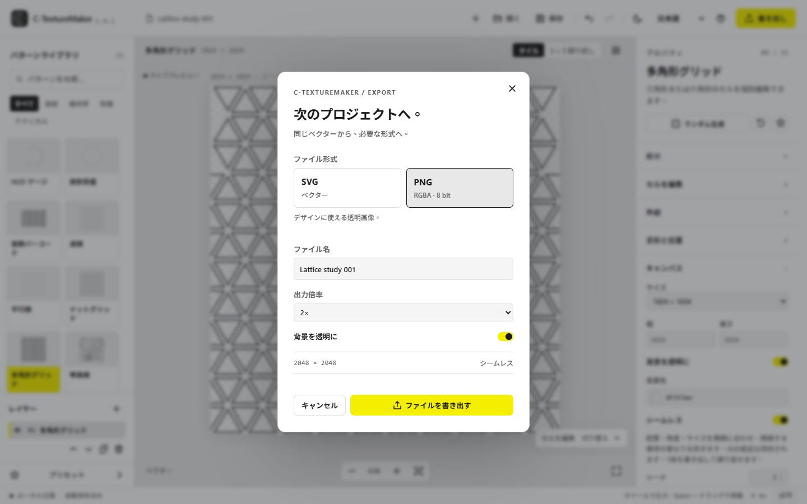
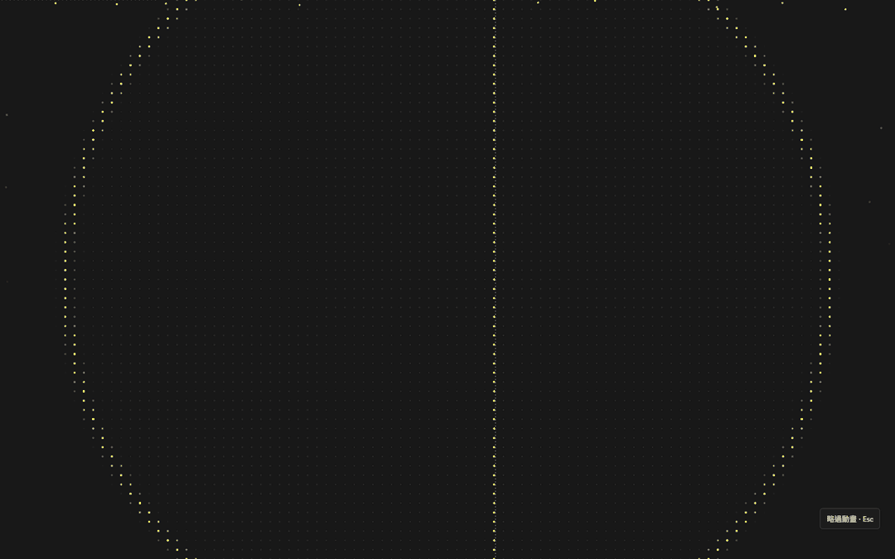
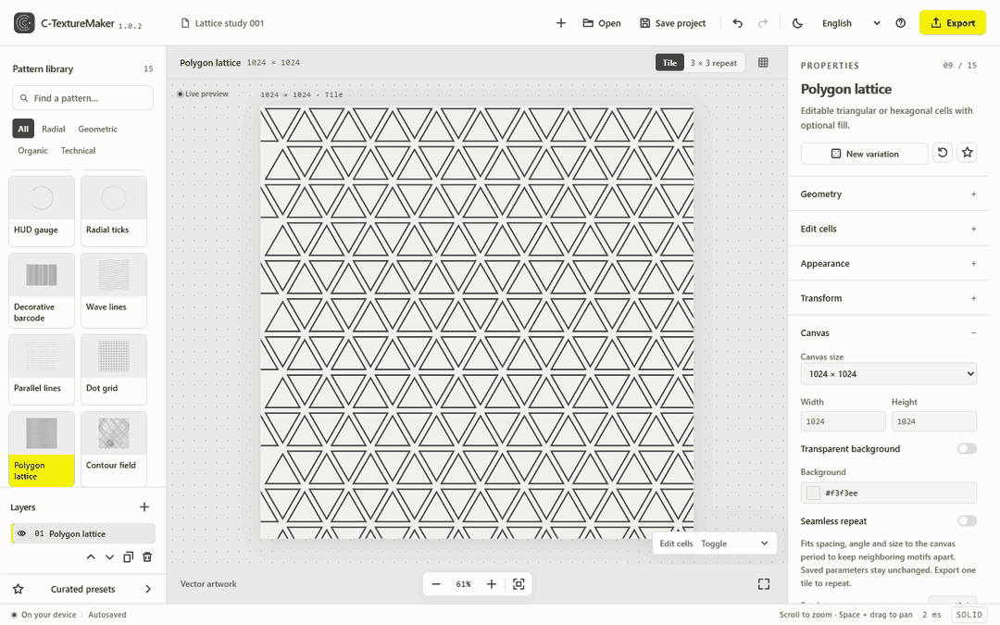

# C-TextureMaker

17 種類の調整可能なパターンから、透明・シームレス対応素材を作成して SVG／PNG に書き出す、オフライン Windows 向けパターンスタジオです。

[繁體中文](README.md) · [English](README.en.md) · [日本語](README.ja.md)

**v1.5.0 公開プレビュー** · [Windows x64 ポータブル版をダウンロード](https://github.com/ga643116/C-TextureMaker/releases/download/v1.5.0/C-TextureMaker-1.5.0-win-x64.zip) · [Release](https://github.com/ga643116/C-TextureMaker/releases/tag/v1.5.0) · [ソースコード](https://github.com/ga643116/C-TextureMaker)

[1.5.0 の主な変更点](docs/releases/v1.5.0.md#日本語)

**今回の更新**：Pixel 変換、編集可能なパレット、実ピクセルサイズ出力、複数選択とドラッグ操作に対応したレイヤーのグループ管理を追加しました。

https://github.com/user-attachments/assets/21d313f7-39f2-4a93-adfb-ed1bd84d94a5

その他のワークスペース画面

**等高線の生成** — 設定したパラメーターから等高線が生成される様子です。

**シームレス書き出し** — 1 枚のタイルと、そのシームレスな反復を確認できます。

> **開発中：1.6.0**（未公開）では「形状再描画」を追加。色面／3色、元の色とパレット、線画、分割の細かさ、直線化を調整できます。生成後の領域は非表示・復元・色変更でき、プロジェクトにも保存されます。上のダウンロードは1.5.0です。

## 機能

- 17 種類のパターン：同心円弧、ハーフトーンドット、HUD ゲージ、円形目盛り、装飾バーコード、波線、平行線、ドットグリッド、多角形グリッド、等高線、ローポリ、シンボル配列、入れ子多角形、地球儀、エンジニアリンググリッド、放射光線、Pixel。
- Pixelは2〜256色、自動抽出・内蔵・カスタムパレット、サンプリング、ディザリング、キャンバスサイズ／実ピクセルサイズ出力に対応。Ctrl+Gでグループ化し、複数選択やドラッグで並べ替え・グループ内外への移動ができます。
- 形状、色、回転、拡大縮小、位置をリアルタイム調整。レイヤー、プリセット、元に戻す／やり直し、.ctm プロジェクトに対応します。最大 16 のコンテンツレイヤーと 16 のグループを使用でき、作業と設定はローカルに自動保存されます。
- シームレスモードはキャンバス周期に合わせて配置します。3 × 3 プレビューで継ぎ目を確認でき、書き出しは 1 タイルです。
- カーソルと手のひらツールを切り替え、Space＋ドラッグで一時的に移動できます。ドット・多角形のセルは直径を調整できる描画／消去ブラシに対応し、1ストロークずつ元に戻せます。
- 共通 PNG／SVG 形状の名前を変更し、ハーフトーン、ドット、多角形格子、シンボルで再利用できます。各レイヤーで元の色を保持するか、透明度を保ったままメインカラーで着色できます。
- ドット・多角形の2つのセルを幅調整可能な線で接続し、そのまま書き出せます。画像マスクは独立したレイヤーとして保存され、左下のレイヤー欄でしきい値を調整できます。パターンの密度や回転を変更してもマスク範囲はキャンバスに固定されます。
- 基本グリッドと対角線の破線設定は独立しています。
- 繁体字中国語、英語、日本語の UI と、ダーク／ライトテーマを用意しています。

## ダウンロードと起動

1. [C-TextureMaker-1.5.0-win-x64.zip](https://github.com/ga643116/C-TextureMaker/releases/download/v1.5.0/C-TextureMaker-1.5.0-win-x64.zip) をダウンロードし、全体を展開します。
2. C-TextureMaker.exe を起動します。app フォルダーと DLL は隣に残してください。
3. 書き込み可能な場所にフォルダー全体を置くと、隣接する data フォルダーに作業と設定を保存できます。

必要環境は Windows x64、.NET Framework 4.7.2 以降、システムにインストール済みの Microsoft Edge WebView2 Runtime です。オフラインで動作し、Node.js、Python、アカウント、開発サーバーは不要です。システムコンポーネントのインストールや更新は行いません。終了前にステータスバーの「自動保存済み」を確認してください。デザインの移動やバックアップには .ctm プロジェクトを別途保存してください。

## パターンと書き出し

キャンバスは各辺 128～4096 px。PNG は透明または単色背景、1×・2×・4×に対応します。出力上限は長辺 8192 px、総画素数 32 MP で、両方の制限が適用されます。

プロシージャルパターンはベクター SVG として書き出されます。読み込んだ PNG はラスター画像として SVG に埋め込まれるため、その SVG は完全なベクターではありません。ハーフトーン、ドット、多角形格子、シンボルで PNG／SVG の形状を共用し、元の色を保持するか、透明度を保ってレイヤーのメインカラーで着色できます。ローカルライブラリの上限は40個・合計32 MiB、1ファイル4 MiBです。適用済みの形状はプロジェクトに埋め込まれ、ライブラリから削除しても残ります。ハーフトーンは透明マスクにも対応します。装飾バーコードはスキャン用途ではありません。

左下の「レイヤー」横の画像ボタンからマスクを追加します。PNG／JPG／WebP（16 MiBまで）またはSVG（4 MiBまで）、各辺8192 pxまでに対応。初期設定では暗い部分を残し、透明部分は空白にします。しきい値と反転はいつでも変更できます。画像レイヤーを選択し、移動・拡大縮小・回転・左右／上下反転を個別に調整できます。タイル表示では枠やハンドルを直接ドラッグできます。「画像」モードでは下の画像またはグループのマスクを使用します。従来のグローバルマスクも保持し、複数ある場合は共通部分を残します。既存のセル編集も保持します。元画像は.ctmに保存され、SVGにはマスクとして埋め込まれます。PNGにも同じ効果が反映されます。画像の端は自動でシームレスにならないため、3 × 3表示で継ぎ目を確認してください。

同じ2つのセルを再び結ぶと接続線を削除でき、Escで始点を解除できます。

画像レイヤーは「白黒マスク」「画像の色」「元画像を表示」を切り替えられ、しきい値の設定も保持します。各パターンは「全レイヤー／画像／画像なし」を選択できます。「画像」は下の画像またはグループを参照し、複数の効果が同じベースを共有してレイヤー順に重なります。ローポリは三角面ごとに色を採り、他のパターンは形状に画像の色を適用します。密度・回転・画像の変形を変更すると即座に反映されます。「外観」の「画像から着色」で色レイヤーを直接追加できます。

ローポリは頂点密度、形状の変化、メイン・サブカラー、グラデーション角度、色の変化を調整できます。等高線の「立体塗り」では影の内側・外側、ぼかし、距離、角度、色、不透明度を設定でき、オフにすると従来の線表示に戻ります。

最初の保存時に場所を選び、次回から同じファイルを更新します。右側の矢印またはCtrl+Shift+Sで別名保存できます。.ctmを開いた場合もそのファイルへ保存します。各レイヤーのパターン設定とセル編集は切り替え後も記憶され、プロジェクトにも保存されます。リセットは現在のパターンだけに適用されます。

1.5.0は旧プロジェクトと既存の画像参照を保持します。Pixelやグループを含むプロジェクトは1.5.0以降で開いてください。

## ソースからビルド

ビルドには Node.js/npm と Python が必要です。以下のコマンドで依存関係をインストールし、自動テスト、フロントエンドと Windows デスクトップ版のビルド、パッケージ作成を行います。

    npm ci
    npm test
    npm run build
    powershell -NoProfile -ExecutionPolicy Bypass -File .\build-desktop.ps1
    python scripts/package.py

ブラウザー操作の回帰テストには Playwright と Microsoft Edge を用意し、`npm run build` の後に `node tests/editor.browser.cjs` / `node tests/features.browser.cjs` を実行します。

デスクトップ版の初回ビルド時、固定バージョンの WebView2 SDK を NuGet から取得します。配布アプリの実行にビルドツールや開発サーバーは不要です。

## ライセンスとクレジット

本プロジェクト独自のソースコードは [MPL-2.0](https://www.mozilla.org/MPL/2.0/) です。適用範囲は [LICENSE-SCOPE.md](LICENSE-SCOPE.md) を参照してください。商用利用が可能です。MPL 対象ファイルを変更して配布する場合、その変更済みファイルのソースコードを MPL-2.0 で提供する必要があります。全文は [LICENSE](LICENSE) をご覧ください。

Transitions.dev のアニメーションと Microsoft WebView2 コンポーネントには各自の条件が適用され、製品全体を MPL-2.0 のみで提供するものではありません。[第三者ライセンス表示](THIRD-PARTY-NOTICES.txt)、[Transitions.dev のライセンス](app/vendor/LICENSE.txt)、ポータブル版の LICENSE-WebView2.txt を参照してください。

パターンのワークフローは [rahoo 素材生成](https://rahoo.online/) を参考にしています。この実装は同サイトのコードや画像素材を複製していません。起動時の生成アニメーションは [Transitions.dev 公式ソース](https://github.com/Jakubantalik/transitions.dev/tree/main/skills/transitions-ui-generation) に基づきます。
